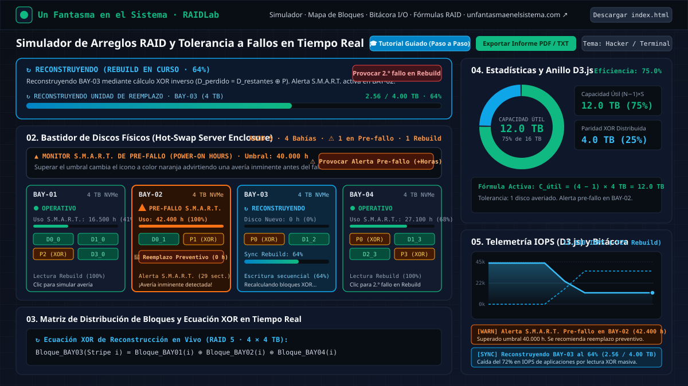
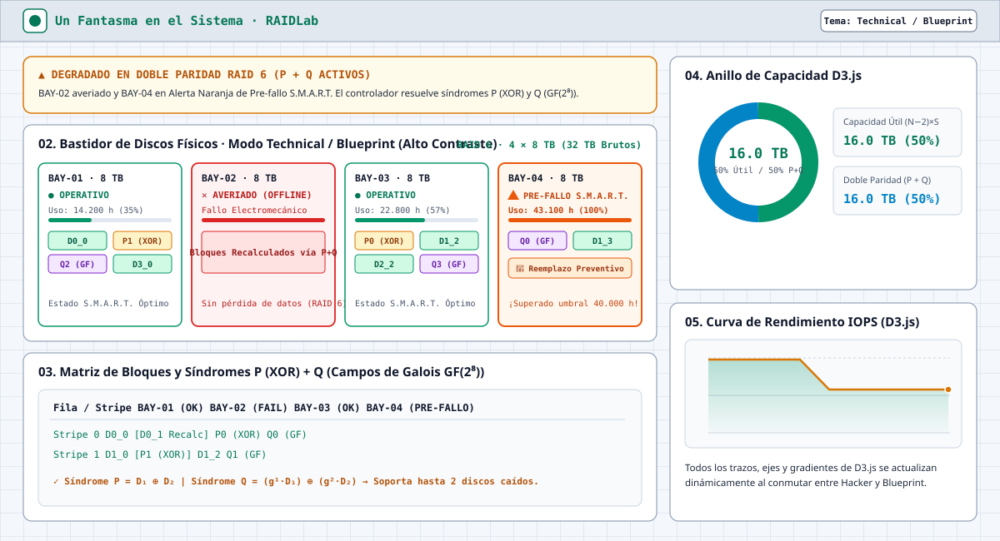
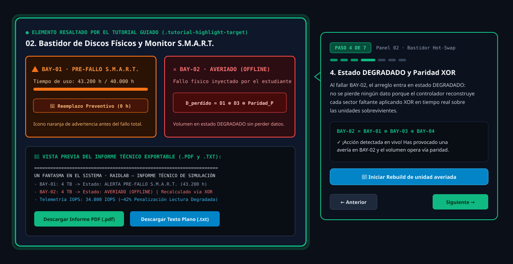

<div align="center">

<a href="https://www.unfantasmaenelsistema.com/" target="_blank" rel="noopener noreferrer">
  
</a>

# Un Fantasma en el Sistema · RAIDLab

### Simulador Interactivo de Arreglos RAID, Tolerancia a Fallos, Telemetría D3.js y Alertas S.M.A.R.T. de Pre-fallo

[](https://www.unfantasmaenelsistema.com/)
[](#despliegue-y-ejecucion)
[](#visualizacion-dinamica-con-d3js)
[](./LICENSE)

**Herramienta pedagógica interactiva de administración de sistemas y almacenamiento empresarial.**  
Permite configurar arreglos **RAID 0, RAID 1, RAID 5, RAID 6 y RAID 10**, inspeccionar la distribución algebraica de bloques y paridad (`XOR` y Campos de Galois `GF(2⁸)`), analizar el tiempo de uso (**Power-On Hours**) mediante **Alertas Naranjas de Pre-fallo S.M.A.R.T.**, inyectar averías en caliente o durante una reconstrucción (*Rebuild*) y exportar informes de laboratorio en **PDF / TXT**.

[🌐 **Visitar Un Fantasma en el Sistema**](https://www.unfantasmaenelsistema.com/) · [📖 **Fundamentos Matemáticos**](#fundamentos-matematicos-de-tolerancia-a-fallos) · [🎓 **Modo Tutorial Guiado**](#modo-tutorial-guiado-paso-a-paso)

</div>

---

## 📸 Capturas de Pantalla

### 1. Tema Oscuro `Hacker / Terminal` · Alertas Naranjas S.M.A.R.T. de Pre-fallo y Rebuild en Curso
> Visualización del bastidor Hot-Swap donde `BAY-02` supera el umbral de horas de uso (`42.400 h / 40.000 h`) activando el **icono naranja de Pre-fallo S.M.A.R.T.**, mientras `BAY-03` ejecuta un *Rebuild* al 64% y los gráficos **D3.js** reflejan en tiempo real la eficiencia de capacidad y la caída del 72% en IOPS.



---

### 2. Tema Claro `Technical / Blueprint` (Alto Contraste) · Doble Paridad RAID 6 (`P + Q`)
> Conmutación instantánea a estética de plano de ingeniería de alto contraste. Todos los trazos, ejes, pistas y gradientes de los gráficos **D3.js** se actualizan dinámicamente al cambiar de tema.



---

### 3. Modo `Tutorial Guiado Paso a Paso` y Exportador de Informes de Laboratorio (`.PDF` / `.TXT`)
> Recorrido didáctico de 7 pasos que resalta cada panel de la interfaz mediante foco luminoso y tooltips interactivos que reaccionan en tiempo real a las acciones del estudiante.



---

## ✨ Características Principales

- **🎛️ Panel de Configuración con Validación Estricta de Topología**:
  - Soporte para **RAID 0, RAID 1, RAID 5, RAID 6 y RAID 10 (1+0)**.
  - Validación automática del mínimo de unidades físicas (`N ≥ 2` en RAID 0/1, `N ≥ 3` en RAID 5, `N ≥ 4` en RAID 6, `N ≥ 4` y **obligatoriamente par** en RAID 10) y tamaño por unidad (`1 TB` a `20 TB`).
- **🟠 Sistema S.M.A.R.T. de Alertas de Pre-fallo por Tiempo de Funcionamiento (*Power-On Hours*)**:
  - Cada bahía monitoriza sus horas de encendido acumuladas (`POH`) y sectores reasignados frente a un umbral configurable (`20.000 h – 50.000 h`, por defecto `40.000 h`).
  - Al superar el umbral de uso, la unidad cambia su icono de estado a un **icono de advertencia naranja pulsante (`⚠️ PRE-FALLO S.M.A.R.T.`)** para alertar de una avería inminente antes de que alcance el colapso electromecánico (`55.000 h`).
  - Incluye botón de **Reemplazo Preventivo (`0 h`)** en cada bahía afectada, botón para inyectar desgaste inmediato (`+Horas`) y reloj de **Auto-Desgaste continuo** (que se acelera bajo el estrés térmico/mecánico de un *Rebuild*).
- **🖴 Bastidor Virtual Hot-Swap y Simulación de Fallos Catastróficos en Rebuild**:
  - Haz clic en cualquier disco para provocar una avería física (`✕ AVERIADO`).
  - Inicia el **Rebuild** con barra de progreso animada y provoca un **2.º fallo concurrente en pleno Rebuild** para demostrar por qué un RAID 5 colapsa mientras un RAID 6 sobrevive.
- **📊 Visualización Dinámica con D3.js (v7)**:
  - **Gráfico de Anillos Interactivo (`#d3-capacity-donut`)**: Representa la proporción exacta de **Capacidad Útil Efectiva** frente a **Redundancia / Paridad** con transiciones suaves de arco, tooltips e inspección por segmento.
  - **Gráfico Lineal de Telemetría IOPS (`#d3-iops-line-chart`)**: Muestra en vivo cómo caen los IOPS servidos al Host cuando un disco entra en estado *Degradado* o *Reconstruyendo (Rebuild)*, contraponiendo la línea punteada de tráfico interno de paridad.
- **🎓 Modo Tutorial Guiado Paso a Paso**:
  - Recorrido interactivo de 7 etapas con resaltado de elementos (`.tutorial-highlight-target`) y tooltips flotantes que explican los conceptos de **paridad XOR, síndromes Reed-Solomon, degradación y caída de rendimiento** mientras el usuario interactúa con el simulador.
- **🌓 Conmutador de Tema (`Hacker / Terminal` ↔ `Technical / Blueprint`)**:
  - Alterna entre modo oscuro técnico y modo claro de alto contraste con persistencia en `localStorage` y repintado reactivo de todos los gráficos D3.js.
- **📄 Exportador de Informes de Simulación (`.PDF` y `.TXT`)**:
  - Genera un informe técnico multipágina en **PDF** (vía `jsPDF`) o en **texto plano (`.txt`)** con los datos del estudiante/grupo, fórmulas algebraicas, estado S.M.A.R.T. de cada bahía, telemetría IOPS e historial cronológico de eventos.

---

## 🧮 Fundamentos Matemáticos de Tolerancia a Fallos

Sea $N$ el número total de discos físicos instalados y $S$ la capacidad individual de cada disco en Terabytes ($\text{TB}$), con una capacidad bruta total $C_{\text{bruta}} = N \times S$:

| Nivel RAID | Mín. Discos ($N$) | Capacidad Útil ($C_{\text{útil}}$) | Capacidad Redundancia ($C_{\text{red}}$) | Eficiencia | Tolerancia a Fallos | Ecuación Algebraica / Redundancia |
| :--- | :---: | :---: | :---: | :---: | :---: | :--- |
| **RAID 0** | $N \ge 2$ | $N \times S$ | $0\text{ TB}$ | $100\%$ | **$0\text{ discos}$** | Fragmentación pura (*Striping*) sin paridad. Si falla 1 disco, pérdida total. |
| **RAID 1** | $N \ge 2$ | $1 \times S$ | $(N - 1) \times S$ | $\frac{1}{N}$ | **$N - 1\text{ discos}$** | Espejado completo (*Mirroring*). Sobrevive mientras quede $\ge 1$ unidad sana. |
| **RAID 5** | $N \ge 3$ | $(N - 1) \times S$ | $1 \times S$ | $\frac{N - 1}{N}$ | **$1\text{ disco}$** | Paridad simple distribuida XOR: $P = D_1 \oplus D_2 \oplus \dots \oplus D_{N-1}$. |
| **RAID 6** | $N \ge 4$ | $(N - 2) \times S$ | $2 \times S$ | $\frac{N - 2}{N}$ | **$2\text{ discos}$** | Doble paridad independiente $P$ ($\text{XOR}$) + $Q$ ($\text{GF}(2^8)$ Reed-Solomon). |
| **RAID 10** | $N \ge 4$ (Par) | $\frac{N}{2} \times S$ | $\frac{N}{2} \times S$ | $50\%$ | **$1\text{ a }\frac{N}{2}\text{ discos}^*$** | $K = \frac{N}{2}$ subgrupos espejo (RAID 1) unidos en Stripe (RAID 0). |

> **Nota sobre RAID 10 ($^*$)**: El volumen sobrevive a múltiples fallos simultáneos (hasta $N/2$ discos) **siempre que ocurran en subgrupos espejo distintos**. Si fallan las 2 unidades de un mismo subgrupo espejo, se pierde ese segmento del Stripe global y el volumen entra en **Fallo Crítico**.

---

## 🚀 Despliegue y Ejecución

### Opción A: Ejecución Directa Sin Servidor (Archivo Único `index.html`)
El simulador completo está contenido en `index.html`. Puedes abrirlo directamente en cualquier navegador moderno o alojarlo en **GitHub Pages** sin necesidad de backend:

```bash
# Clonar el repositorio
git clone https://github.com/tu-usuario/raidlab-simulador-raid.git
cd raidlab-simulador-raid

# Abrir directamente index.html en el navegador (o usar cualquier servidor estático)
npx serve .
```

### Opción B: Entorno de Desarrollo con Vite
Si deseas ejecutarlo con el servidor de desarrollo local incluido en el repositorio:

```bash
npm install
npm run dev
```
La aplicación estará disponible en `http://localhost:3000`.

---

## 📁 Estructura del Proyecto

```text
├── docs/
│   └── screenshots/
│       ├── captura-modo-hacker-smart.svg        # Captura Modo Hacker + Alertas S.M.A.R.T. + D3.js
│       ├── captura-modo-blueprint-raid6.svg     # Captura Modo Claro Blueprint + RAID 6
│       └── captura-tutorial-guiado-y-reporte.svg# Captura Tutorial Guiado + Exportador PDF/TXT
├── public/
│   └── assets/
│       └── aistudio/
│           └── icono_81a3db5b.png               # Logo oficial de Un Fantasma en el Sistema
├── index.html                                   # Simulador autónomo completo (HTML5 + CSS + D3.js + JS)
├── package.json                                 # Scripts de construcción y servidor local Vite
├── LICENSE                                      # Licencia MIT
└── README.md                                    # Documentación completa del proyecto
```

---

## 🔗 Autoría y Comunidad

Desarrollado para **[Un Fantasma en el Sistema](https://www.unfantasmaenelsistema.com/)** — Recursos técnicos de ciberseguridad, administración de sistemas, redes y laboratorios prácticos de IT.
