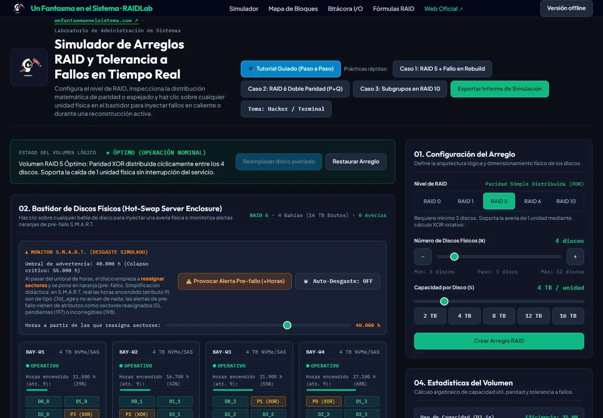
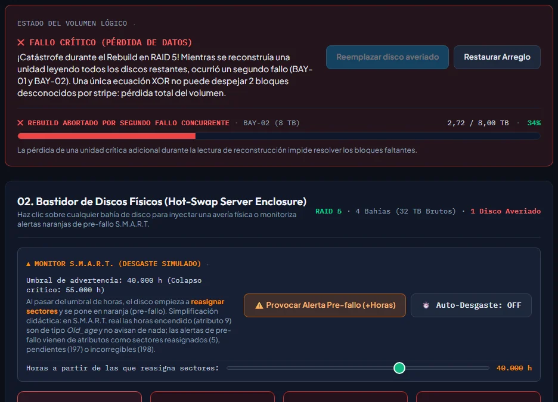
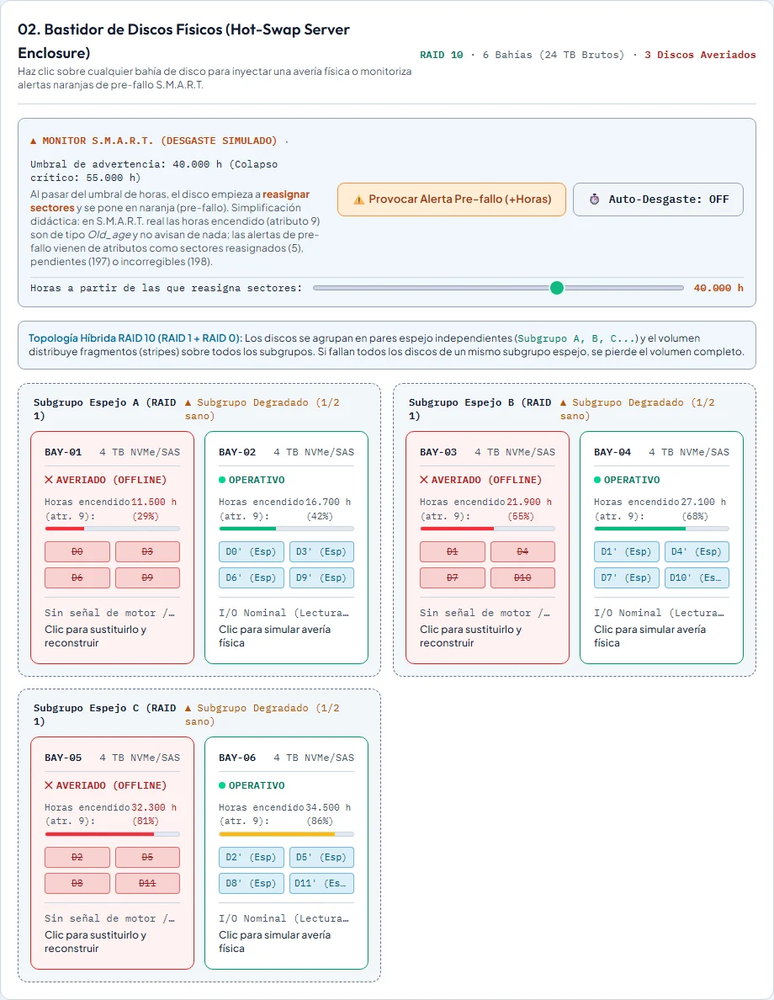
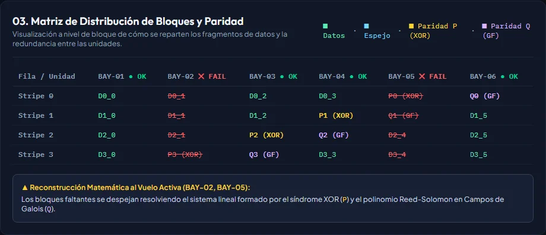
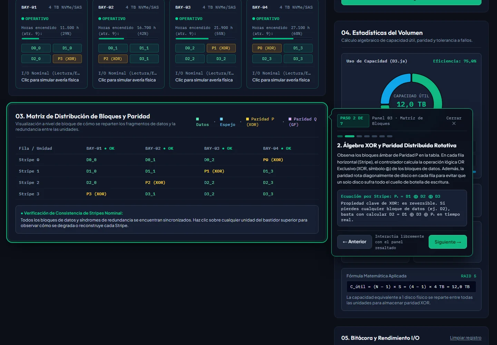

<p align="center">
  <a href="https://www.unfantasmaenelsistema.com"></a>
</p>

<h1 align="center">RAIDLab</h1>

<p align="center">
  <b>Simulador de RAID y tolerancia a fallos para clase</b><br>
  RAID 0, 1, 5, 6 y 10 · Averías en caliente y durante el rebuild · Paridad bloque a bloque · Informe en PDF
</p>

<p align="center">
  <a href="https://unfantasmaenelsistema.github.io/RAIDLab/"><b>▶ Abrir el simulador</b></a> ·
  <a href="#qué-hace">Qué hace</a> ·
  <a href="#para-clase">Para clase</a> ·
  <a href="#cómo-calcula">Cómo calcula</a> ·
  <a href="https://www.unfantasmaenelsistema.com">unfantasmaenelsistema.com</a> ·
  <a href="LICENSE">MIT</a>
</p>

<p align="center">
  
  
  
  
</p>

<p align="center">
  
</p>

Configuras un arreglo, haces clic en un disco para averiarlo y ves qué le pasa al volumen: si sigue vivo, cuánto rendimiento pierde, cómo se reconstruye y qué ocurre si cae otro disco a mitad de la reconstrucción. Todo con la matriz de bloques, la fórmula de capacidad y una bitácora del controlador a la vista.

> [!NOTE]
> Es un modelo didáctico. Las reglas de tolerancia a fallos y las fórmulas de capacidad son las reales; los IOPS, los tiempos de reconstrucción y el desgaste de los discos son aproximaciones para que se vea el efecto en clase.

## Qué hace

- **Cinco niveles** (RAID 0, 1, 5, 6 y 10) con sus reglas de discos mínimos y número par en RAID 10, de 2 a 12 bahías y de 1 a 20 TB por disco.
- **Averías en el bastidor**: clic en un disco sano para averiarlo; clic en uno averiado para sustituirlo y reconstruirlo. Con el volumen perdido, sustituir discos ya no lo recupera (hace falta la copia de seguridad).
- **Rebuild en vivo** con barra de progreso y un botón para provocar el 2.º fallo en plena reconstrucción: RAID 5 cae, RAID 6 aguanta y en RAID 10 depende de si cae el hermano del mismo par.
- **Matriz de bloques**: datos, espejos y paridad rotativa P (XOR) y Q (Reed-Solomon) stripe a stripe, con la explicación de cómo se recupera cada bloque.
- **Estadísticas**: capacidad bruta, útil y de redundancia, eficiencia en un anillo D3 y la fórmula con los valores del arreglo.
- **Rendimiento**: IOPS del volumen con la penalización de escritura de cada nivel y la caída en modo degradado y durante el rebuild, en un gráfico que avanza segundo a segundo.
- **Monitor S.M.A.R.T. simulado**: al envejecer, un disco reasigna sectores y se pone en naranja (pre-fallo); se puede sustituir preventivamente o dejar que falle.
- **Tutorial guiado** de 7 pasos (paridad, coste de la redundancia, degradación, rebuild, rendimiento y doble fallo) y **3 casos rápidos** para clase.
- **Informe** de la práctica en PDF o TXT con el estado final, los cálculos, el inventario de bahías y la bitácora.
- Tema oscuro y claro (recuerda tu elección y, si no hay, sigue al sistema), usable con teclado y sin desbordes en móvil.

<p align="center">
  
</p>

## Para clase

1. **Caso 1 · RAID 5 + fallo en rebuild**: un disco ya ha caído y la reconstrucción arranca sola. Pide a la clase que prediga qué pasa si cae otro disco ahora y pulsa **Provocar 2.º fallo en Rebuild**.
2. **Caso 2 · RAID 6 doble paridad**: dos discos caídos y el volumen sigue entero. Un tercer fallo lo destruye.
3. **Caso 3 · Subgrupos en RAID 10**: tres discos caídos, uno por par espejo, y el volumen vive; si cae el hermano de cualquiera de ellos, se pierde todo.
4. Al terminar, **Exportar informe de simulación** con el nombre del alumno o del grupo y sus conclusiones.

¿Aula sin Internet? Pulsa **Versión offline**: descarga el simulador completo en un solo archivo (`raidlab.html`, ~1,5 MB) que funciona con doble clic y sin conexión, informe PDF incluido.

<p align="center">
  
  
</p>

## Cómo calcula

| Nivel | Discos | Capacidad útil | Aguanta | Penalización de escritura |
| --- | :---: | --- | --- | :---: |
| RAID 0 | ≥ 2 | N × S | 0 discos | 1 |
| RAID 1 | ≥ 2 | S | N − 1 discos | N |
| RAID 5 | ≥ 3 | (N − 1) × S | 1 disco | 4 |
| RAID 6 | ≥ 4 | (N − 2) × S | 2 discos cualesquiera | 6 |
| RAID 10 | ≥ 4, par | (N / 2) × S | 1 seguro; hasta N/2 si caen en pares distintos | 2 |

- Un disco **reconstruyéndose** aún no tiene sus datos completos: cuenta como no disponible. Por eso en RAID 5 un fallo durante el rebuild pierde el volumen.
- **IOPS** = N × 15.000 / (0,7 + 0,3 × penalización), con 15.000 IOPS por disco (SSD) y una carga de 70 % lectura / 30 % escritura. En modo degradado y durante el rebuild se aplica una caída aproximada, mayor con paridad que con espejo.
- **S.M.A.R.T.**: en un disco real las horas encendido (atributo 9) no disparan ninguna alerta; las de pre-fallo vienen de atributos como sectores reasignados (5), pendientes (197) o incorregibles (198). Aquí, para que se vea en clase, el disco empieza a reasignar sectores al pasar de un umbral de horas que puedes mover.

<p align="center">
  
</p>

## Usarlo en local

```bash
git clone https://github.com/unfantasmaenelsistema/RAIDLab.git
cd RAIDLab
npm ci
npm run dev      # http://localhost:3000
npm test         # 11 pruebas del motor (node --test, sin navegador)
npm run build    # web en dist/ + dist/raidlab.html (versión offline)
```

Necesitas Node.js 22 o superior. El motor está en `src/lib/raid.js` sin DOM (reglas de cada nivel, capacidad, estado del volumen, reparto de bloques e IOPS) y es lo que cubren las pruebas; `src/app.js` es la interfaz en JavaScript sin framework, con d3 y jsPDF empaquetados, y `index.html` el marcado (Tailwind compilado con Vite). Cada cambio en `main` se prueba y se publica en GitHub Pages con `.github/workflows/pages.yml`.

## Cambios

**v2.0 (2026-10-25)** — revisada al pasar a la organización. La v1 la generó Google AI Studio y tenía estos problemas:

- **No se podía publicar**: no había workflow, el proyecto React/Vite estaba vacío (la app entera iba en `index.html`) y el logo usaba rutas absolutas que en `…github.io/RAIDLab/` daban 404.
- **Dependía de tres CDN**: Tailwind en modo «play» (el propio Tailwind avisa de que no es para producción), d3 sin versión fija y jsPDF 2.5.2, con vulnerabilidades conocidas. La «descarga de index.html» copiaba la página tal cual: sin Internet no tenía estilos, gráficos ni logo.
- **Un volumen perdido «resucitaba»**: tras un fallo crítico bastaba con hacer clic en el disco averiado para devolverlo a la vida y el arreglo volvía a degradado. Ahora un disco averiado se sustituye y reconstruye, y con el volumen perdido no hay vuelta atrás sin restaurar.
- **S.M.A.R.T. mal explicado**: presentaba las horas de uso como la causa de la alerta de pre-fallo. Ahora el texto explica qué atributos avisan de verdad.
- **IOPS**: RAID 5, 6 y 10 se calculaban sin penalización de escritura, y el eje «últimos 25 s» no era real (los puntos se añadían a cada clic o cada 150 ms durante el rebuild).
- **Detalles**: el último paso del tutorial no hacía nada si llegabas con el volumen degradado; el consejo de «provoca otro fallo» seguía visible con el volumen ya perdido; los informes PDF mostraban `−` y `⊕` como caracteres rotos; cifras con punto decimal inglés; desborde horizontal en pantallas medianas; Google Fonts; capturas del README dibujadas a mano.

## Créditos y licencia

Hecho por **[Un Fantasma en el Sistema](https://www.unfantasmaenelsistema.com/)** para las clases de administración de sistemas. Código abierto bajo licencia [MIT](LICENSE). Usa [d3](https://d3js.org/) (ISC), [jsPDF](https://github.com/parallax/jsPDF) (MIT) y las fuentes Outfit, Plus Jakarta Sans e IBM Plex Mono (OFL) vía [Fontsource](https://fontsource.org/).
